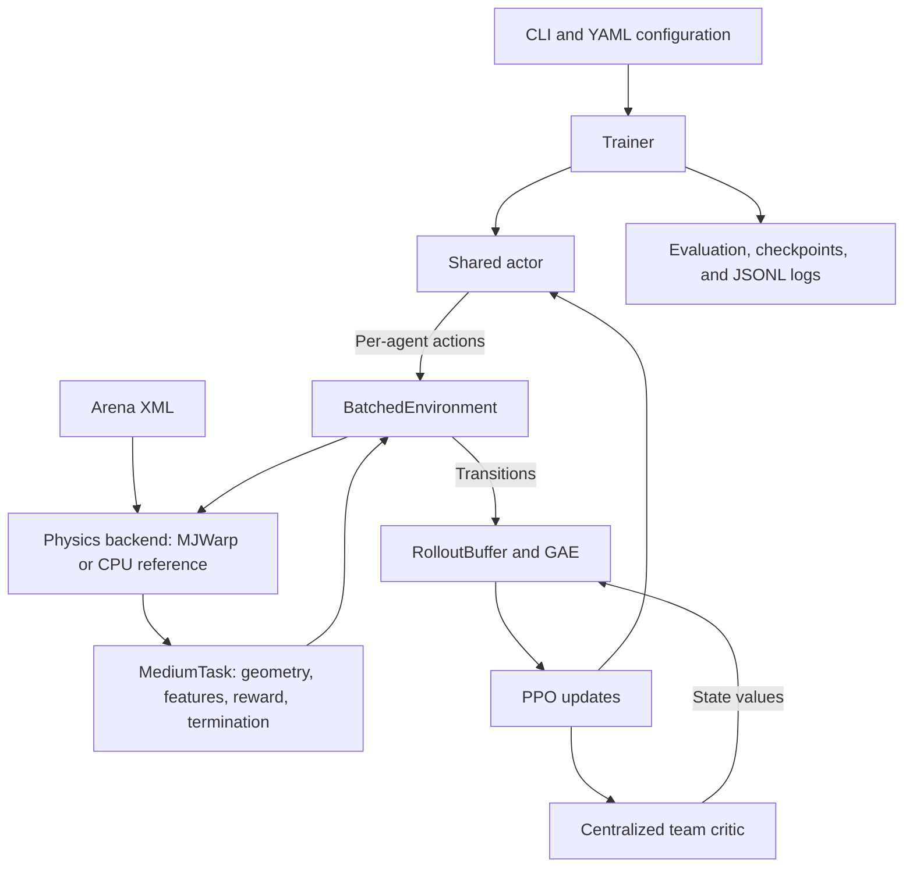

# T-Shape MJWarp

T-Shape MJWarp is a cooperative multi-agent reinforcement learning project for
planar object transport. A team of force-controlled agents learns to push an
asymmetric rigid object through a narrow doorway using Multi-Agent Proximal
Policy Optimization (MAPPO).

The project combines parallel MuJoCo Warp (MJWarp) simulation with PyTorch policy
training. It includes arena visualization, configurable agent counts and spawn
randomization, checkpointing, deterministic policy evaluation, video recording,
numerical validation, and throughput benchmarks.

## Task and arena

The supported training task is `medium`: transport the entire object from the
negative-X side of a partition to the positive-X side through one opening.

| Property | Current setting |
| --- | --- |
| Interior arena bounds | X and Y in `[-2.9, 2.9]` meters |
| Doorway opening | `0.50 m`, centered at Y = 0 |
| Partition thickness | `0.03 m` along X |
| Object | One rigid body composed of three boxes; X, Y, and yaw motion |
| Agents | Cylinders with `0.03 m` radius and X/Y translation |
| Agent count | Configurable from 1 to 16; default 4 |
| Control | Two continuous force commands per agent; up to ±3 N per axis |
| Physics timestep | `0.001 s` |
| Physics substeps per action | 50 |
| Policy control interval | `0.05 s` / 20 Hz |
| Episode limit | 500 decisions / 25 simulated seconds |
| Crossing margin | `0.05 m` beyond the exit face of the partition |

Success requires every object corner to pass the exit plane plus the crossing
margin. Reaching the goal with only the object's center is insufficient. The
goal coordinates provide a reward reference; success does not require settling
inside the displayed goal rectangle.

The physics model is idealized and planar: moving bodies have fixed height,
gravity is zero, and the floor is visual only. Joint damping and dry friction
provide resistance to object motion. Agents interact with the object through
contact; there is no gripper or attachment mechanism.

Arena geometry, masses, force limits, damping, and friction are defined in
[`assets/arena.xml`](assets/arena.xml). MuJoCo box `size` values are half-extents:
the partition's X size of `0.015` produces a full thickness of `0.03 m`.

## Architecture



### Simulation and task layers

- **`physics.py`** implements two explicit backends. `mjwarp` simulates multiple
  worlds through MuJoCo Warp; `reference` runs C MuJoCo instances on the CPU for
  debugging and correctness comparisons. CUDA requests never silently fall back
  to CPU. `mjwarp` with `--device cpu` is also available for diagnostic runs.
- **`environment.py`** provides a dense tensor API across all worlds. It tracks
  episode state, returns terminal features before reset, and supports masked
  resets without restarting healthy worlds. Empty reset masks skip sampling and
  physics forwarding; detecting an empty CUDA mask requires one host scalar read
  and stream synchronization, whose performance impact depends on the workload.
- **`task.py`** computes geometry, observations, team state, doorway-aware
  distances, rewards, and boundary penetration using PyTorch tensors.
- **`spawning.py`** samples valid layouts with independent RNG state per world.
- **`kernels.py`** reduces contact data into per-world penetration, contact flags,
  and obstacle contact pairs.

The MJWarp backend exposes its simulation buffers through `wp.to_torch()`.
Physics state, task features, rollout tensors, and policy computation can stay on
the same device. A CPU MuJoCo model supplies model metadata during initialization.
Training uses policy gradients; it does not differentiate through the simulator.

### Actor and critic

MAPPO uses centralized training with decentralized actor execution. All agents
share one actor; a separate critic predicts one scalar value for the team.

| Network | Default architecture | Output |
| --- | --- | --- |
| Shared actor | Observation → Linear(128) → Tanh → Linear(128) → Tanh → Linear(2) | Gaussian mean for two action components |
| Centralized critic | Team state → Linear(256) → Tanh → Linear(256) → Tanh → Linear(1) | Team value `V(s)` |

The actor learns a state-independent log standard deviation and applies `tanh`
to sampled Gaussian actions to keep them in `[-1, 1]`. PPO likelihoods include
the squashing correction. Deterministic evaluation uses the squashed Gaussian
mean. Both networks are feed-forward MLPs.

### Observations and tensor shapes

For `E` parallel environments and `N` agents:

| Quantity | Shape |
| --- | --- |
| Actor observations | `[E, N, 23 + 4N]` |
| Centralized team states | `[E, 22 + 4N]` |
| Actions | `[E, N, 2]` |
| Rewards, values, termination flags | `[E]` |

With four agents, each observation has 39 features and each team state has 38.
Observations include agent position/velocity, relative object and target
positions, object orientation/velocity, other agents, wall clearances, object
contact, remaining time, success status, and doorway features. Coordinates use
world-aligned XY axes. These inputs include information about all other agents;
they do not model limited-range local sensors.

Changing the number of agents changes input dimensions, so a checkpoint is tied
to its training agent count.

### Learning loop and rewards

The trainer collects on-policy rollouts, estimates team advantages with
Generalized Advantage Estimation (GAE), and updates the actor and critic with
PPO. Each agent uses the team's advantage. PPO includes policy clipping, optional
value clipping, entropy regularization, gradient clipping, and KL early stopping.
Observation and state normalization statistics remain fixed during collection
and all PPO epochs, then update for the next rollout.

For healthy transitions, the shared team reward combines distance shaping,
progress toward the target, and a success bonus. Default weights are:

```text
0.1 * (1 - tanh(distance / 2.0))
+ 2.0 * (previous_distance - distance)
+ 20.0 on success
```

A physics failure replaces these components with a `-20.0` penalty. Distance
shaping uses a point-path heuristic through the doorway; full-object crossing
is checked separately. Success and physics failure terminate an episode. Time
limits truncate it: value bootstrapping uses the terminal state, while GAE does
not propagate across the reset into a new episode.

## Repository structure

```text
.
├── assets/
│   └── arena.xml                 # Physical arena, object, agents, and actuators
├── configs/
│   ├── environment.yaml          # Task, agent count, spawning, rewards, limits
│   └── training.yaml             # Simulation and MAPPO settings
├── tshape_mjwarp/
│   ├── cli.py                    # check, validate, benchmark, train, evaluate
│   ├── config.py                 # Environment/simulation configuration loading
│   ├── training_config.py        # Validated MAPPO settings
│   ├── physics.py                # MJWarp and CPU physics backends
│   ├── kernels.py                # Contact reductions
│   ├── environment.py            # Batched environment and partial resets
│   ├── task.py                   # Geometry, features, reward, task metrics
│   ├── spawning.py               # Layout sampling and per-world RNG
│   ├── mappo.py                  # Policy, value function, and PPO updates
│   ├── normalization.py          # Running input normalization
│   ├── rollout.py                # Rollout storage and GAE
│   ├── trainer.py                # Collection, updates, evaluation, and saving
│   ├── checkpoint.py             # Checkpoint serialization and restoration
│   ├── artifacts.py              # JSON/JSONL output utilities
│   ├── evaluation.py             # Seeded deterministic policy evaluation
│   ├── video.py                  # MuJoCo rendering and FFmpeg encoding
│   ├── validation.py             # Numerical comparisons with CPU MuJoCo
│   ├── benchmark.py              # Rollout and PPO throughput measurements
│   └── reference/
│       ├── agents/
│       │   ├── actor.py          # Shared actor used by MAPPO
│       │   └── critic.py         # Centralized critic used by MAPPO
│       └── envs/
│           ├── tshape_env.py     # CPU PettingZoo ParallelEnv
│           ├── physics.py        # CPU MuJoCo mechanics and diagnostics
│           ├── model.py          # XML agent/actuator template expansion
│           ├── config.py         # Environment configuration schema
│           ├── doorway.py        # Doorway geometry and path distances
│           ├── observations.py   # CPU observations and team state
│           ├── spawning.py       # CPU spawn utilities
│           ├── rewards.py        # CPU reward calculation
│           └── termination.py    # CPU goal checks
├── tests/
│   ├── test_task.py              # Features, spawning, reset, success/failure
│   ├── test_rollout.py           # GAE and policy update behavior
│   ├── test_physics.py           # Non-finite substep rollback and path metrics
│   ├── test_validation.py        # Validation inputs, stability, and termination
│   ├── test_checkpoint.py        # Training, resume, evaluation, video, benchmark
│   ├── test_warp_cpu.py          # Optional MJWarp CPU integration tests
│   └── test_gpu.py               # Optional CUDA integration tests
├── requirements.txt
└── README.md
```

`reference/` is an active part of the implementation: its networks are imported
by MAPPO, and its CPU environment supports visualization and numerical checks.

## Installation

Run all commands from the repository root. Use Python 3.11, or Python 3.10 with
the pinned dependencies:

```bash
python3.11 -m venv .venv
.venv/bin/python -m pip install --upgrade pip
.venv/bin/python -m pip install -r requirements.txt
```

The dependency file pins MuJoCo `3.5.0`, mujoco-warp `3.5.0`, warp-lang `1.11.0`,
and PyTorch `2.6.0`, along with NumPy, PyYAML, Gymnasium, and PettingZoo. The MJWarp
backend enforces the pinned MuJoCo/Warp versions. Keep those packages aligned.

GPU runs require an NVIDIA GPU and a CUDA-capable PyTorch installation. FFmpeg
must be on `PATH` for video recording. On Ubuntu, install it with:

```bash
sudo apt install ffmpeg
```

Check package compatibility and CUDA availability:

```bash
.venv/bin/python -m tshape_mjwarp.cli check --json runs/check.json
```

The default device is `cuda:0`. The command exits with a nonzero status if the
requested setup is not ready. Initial Warp compilation may take time; its kernel
cache defaults to `.cache/warp/` when no cache directory is already configured.

## Preview the arena

Open a static arena view without a trained policy or GPU. Run this on a machine
with a desktop/display, and close the viewer to exit. Edit the configuration
arguments to preview different agent counts or randomization settings.

```bash
MUJOCO_GL=glfw .venv/bin/python - <<'PY'
import time

from tshape_mjwarp.config import environment_config
from tshape_mjwarp.reference.envs.tshape_env import TShapeParallelEnv

config = environment_config(
    num_agents=8,
    randomize_agents=True,
    randomize_object_position=False,
    randomize_object_orientation=False,
)
env = TShapeParallelEnv(config.to_dict(), render_mode="human")

try:
    env.reset(seed=42)
    env.render()
    while env.viewer.is_running():
        env.render()
        time.sleep(0.02)
finally:
    env.close()
PY
```

Copy the complete command, including the Python invocation and the closing `PY`
on its own line. This preview displays an initial layout without stepping physics.
To watch a trained policy move, use the evaluation viewer below.

## Training

Train eight agents in 32 parallel GPU worlds with randomized agent positions and
a fixed object pose:

```bash
.venv/bin/python -m tshape_mjwarp.cli train \
  --backend mjwarp \
  --device cuda:0 \
  --num-envs 32 \
  --num-agents 8 \
  --randomize-agents \
  --no-randomize-object-position \
  --no-randomize-object-orientation \
  --total-steps 1000000 \
  --run-dir runs/medium_n8_e32_s42
```

The run directory must be new. `total_steps` counts team transitions across all
worlds and must be divisible by `num_envs`. It does not count individual agent
actions or physics substeps.

### Agent counts and randomization

| Setting | CLI flag | Default YAML value |
| --- | --- | --- |
| Agents per world | `--num-agents 8` | 4 |
| Parallel worlds | `--num-envs 32` | 32 |
| Random agent placement | `--randomize-agents` / `--no-randomize-agents` | Enabled |
| Random object XY position | `--randomize-object-position` / `--no-randomize-object-position` | Disabled |
| Random object yaw | `--randomize-object-orientation` / `--no-randomize-object-orientation` | Disabled |

These randomization flags are available for `train`, `validate`, and `benchmark`.
CLI values override YAML settings. Enable all three randomizations with:

```bash
.venv/bin/python -m tshape_mjwarp.cli train \
  --num-envs 32 --num-agents 8 \
  --randomize-agents \
  --randomize-object-position \
  --randomize-object-orientation \
  --total-steps 1000000 \
  --run-dir runs/medium_random_n8_e32_s42
```

For a fixed layout, use all three `--no-randomize-...` flags. If agent
randomization is disabled while the object pose is randomized, the agent
formation translates and rotates with the object.

Spawn ranges are configured in `configs/environment.yaml`:

- `object_pose: [-1.5, 0.0, 0.0]`: reference X/Y position in meters and yaw in radians.
- `object_position_range: [0.4, 0.6]`: XY half-widths around the reference position.
- `object_yaw_range: [-pi, pi]`: absolute yaw bounds; use numeric values in YAML.
- `spawn_gap_min: 0.04`, `spawn_gap_max: 0.12`: surface gaps in meters between
  agents and the object at spawn.

The batched sampler considers up to 128 object poses and 512 candidates per
agent. It reports an error if candidates are exhausted. Each world has its own
checkpointed RNG state. CPU preview sampling and batched sampling use different
RNG implementations, so identical seeds need not produce identical layouts.

### Custom configuration

Copy the supplied YAML files to new names before creating an experiment:

```bash
cp -n configs/environment.yaml configs/environment_custom.yaml
cp -n configs/training.yaml configs/training_custom.yaml
```

Edit `environment_custom.yaml` for spawning, rewards, episode duration, and
physics failure limits. Edit `training_custom.yaml` for the simulation device,
world count, contact allocation, seed, rollout length, PPO settings, network
sizes, and evaluation/checkpoint intervals. Run with:

```bash
.venv/bin/python -m tshape_mjwarp.cli train \
  --env-config configs/environment_custom.yaml \
  --config configs/training_custom.yaml \
  --total-steps 1000000 \
  --run-dir runs/medium_custom
```

`training.yaml` separates `simulation` and `learning`. Its defaults collect
32 steps in 32 worlds, giving 1,024 team transitions per full update. With four
agents, this supplies 4,096 actor samples. Changing rollout length also changes
the temporal span used by GAE, even if total batch size stays constant.

Programmatic calls to `MAPPO(..., config=None)` or `load_mappo_config()` use
`MAPPOConfig` dataclass defaults without reading a YAML file. The CLI loads the
supplied training YAML; its overrides, including logging settings, remain active.

The supplied training configuration evaluates 20 episodes and saves checkpoints
at intervals of 10,000 team transitions, checked after each rollout/update, and
at the end of training. Keep `tensorboard: false` and `video_interval_steps: 0`;
training currently supports JSONL logging and manual evaluation videos.

For a small CPU run, explicitly select the reference backend and fewer worlds:

```bash
.venv/bin/python -m tshape_mjwarp.cli train \
  --backend reference --device cpu \
  --num-envs 2 --num-agents 4 \
  --total-steps 128 \
  --run-dir runs/cpu_smoke
```

## Evaluation and policy demos

Evaluate a saved policy on 100 episodes:

```bash
.venv/bin/python -m tshape_mjwarp.cli evaluate \
  runs/medium_n8_e32_s42/checkpoints/best.pt \
  --episodes 100 --seed 2000000 \
  --json runs/medium_n8_e32_s42/heldout_100.json
```

Evaluation uses deterministic actor actions. Geometry, agent count,
randomization, and model weights are restored from the checkpoint. They cannot
be changed with evaluation CLI flags. Simulation backend, device, world count,
and contact capacities can be overridden explicitly.

Training monitoring uses episode seeds starting at `1000000`. Use a different
seed range, such as `2000000`, for a separate final evaluation. Reports include
success rate, stable rate, mean return, completion time for successful episodes,
and per-episode diagnostics.

### Interactive viewer

On a machine with a desktop/display:

```bash
MUJOCO_GL=glfw .venv/bin/python -m tshape_mjwarp.cli evaluate \
  runs/medium_n8_e32_s42/checkpoints/best.pt \
  --num-envs 1 --episodes 1 --seed 2000000 \
  --render
```

To run the same checkpoint without CUDA, add `--backend reference --device cpu`.
Backend changes can produce numerical differences in trajectories.

### Video recording

On a headless Linux machine with EGL rendering and FFmpeg available:

```bash
MUJOCO_GL=egl .venv/bin/python -m tshape_mjwarp.cli evaluate \
  runs/medium_n8_e32_s42/checkpoints/best.pt \
  --num-envs 1 --episodes 1 --seed 2000000 \
  --video-dir runs/medium_n8_e32_s42/videos/demo \
  --json runs/medium_n8_e32_s42/demo.json
```

The output is `videos/demo/policy.mp4`. Only the first episode is recorded.
Rendering copies the actual simulated state to the CPU MuJoCo renderer; physics
continues on the selected backend. Default video settings are 1920×1080, H.264,
CRF 18, at the policy control rate.

## Checkpoints and resume

Resume training with a larger cumulative transition budget and a new directory:

```bash
.venv/bin/python -m tshape_mjwarp.cli train \
  --resume runs/medium_n8_e32_s42/checkpoints/latest.pt \
  --total-steps 2000000 \
  --run-dir runs/medium_n8_e32_s42_resume
```

Resume restores simulation settings, agent count, task/randomization settings,
network and optimizer state, input normalization, and RNG state. The CLI accepts
a new cumulative `total_steps`; do not pass configuration or simulation overrides
alongside `--resume`.

Checkpoints contain their XML snapshot and SHA-256 hash. Editing
`assets/arena.xml` affects new runs and previews; evaluation and resume retain
the saved arena. Resume starts new episodes rather than restoring an interrupted
physics state or partially collected rollout.

## Run outputs

```text
runs/<run-name>/
├── manifest.json                 # Configuration, dimensions, software versions
├── arena.xml                     # Model snapshot with the chosen agent count
├── environment.yaml             # Environment configuration snapshot
├── training.yaml                # Simulation and learning configuration snapshot
├── episodes.jsonl               # Completed episodes and task diagnostics
├── updates.jsonl                # PPO losses, gradients, KL, and throughput
├── evaluations.jsonl            # Periodic evaluation results
├── evaluation_best.json         # Best evaluation results
├── evaluation_latest.json       # Most recent evaluation results
└── checkpoints/
    ├── best.pt                   # Policy selected by evaluation score
    └── latest.pt                 # Most recently saved training state
```

Best-policy selection prioritizes higher success rate, then shorter mean
completion time among successes, then higher mean return. Checkpoints also store
actor/critic optimizers, normalization statistics, Torch/CUDA RNG, minibatch RNG,
and per-world spawn RNG.

## Tests and numerical validation

Run the standard suite:

```bash
MUJOCO_GL=egl .venv/bin/python -m unittest discover -s tests -v
```

GPU and MJWarp CPU tests require explicit opt-in. Requesting GPU tests without
CUDA fails rather than reporting successful GPU verification:

```bash
TSHAPE_RUN_GPU_TESTS=1 MUJOCO_GL=egl \
  .venv/bin/python -m unittest discover -s tests -p test_gpu.py -v

TSHAPE_RUN_WARP_CPU_TESTS=1 MUJOCO_GL=egl \
  .venv/bin/python -m unittest discover -s tests -p test_warp_cpu.py -v
```

Compare initial features and a short trajectory against the CPU environment:

```bash
.venv/bin/python -m tshape_mjwarp.cli validate \
  --num-envs 2 --json runs/validate.json

.venv/bin/python -m tshape_mjwarp.cli validate \
  --backend reference --device cpu --num-envs 2
```

Validation copies the first world's initial state into the CPU environment and
applies matching actions. It requires a positive step count and finite, positive
tolerance, reports stability for the batched worlds and CPU reference, and fails
if either simulator reports a physics failure. Validation stops when any tested
world ends. It checks numerical agreement within tolerances;
it does not establish bitwise equivalence, long-horizon agreement, or policy
learning performance. Skipped GPU tests are not evidence of a GPU pass.

## Benchmarks

Measure rollout throughput after warm-up:

```bash
.venv/bin/python -m tshape_mjwarp.cli benchmark \
  --counts 16 32 64 128 --warmup 10 --steps 100 \
  --json runs/benchmark_rollout.json
```

Include data collection and PPO updates:

```bash
.venv/bin/python -m tshape_mjwarp.cli benchmark \
  --counts 16 32 64 128 --warmup 10 --steps 128 \
  --with-updates --json runs/benchmark_training.json
```

Run comparisons without competing GPU workloads. Benchmark reports distinguish:

- `environment_transitions_per_second`: team decisions across all worlds.
- `nominal_physics_substeps_per_second`: transition throughput multiplied by
  frame skip; this is a nominal count rather than measured healthy substeps.
- `torch_peak_allocated_mib`: PyTorch allocations only, excluding Warp allocations.
- `device_free_mib`: overall free GPU memory, also affected by other processes.

Warm-up is excluded from timing and uses the selected execution path. With
`--with-updates`, it includes collection, backward passes, and optimizer steps,
and rounds a positive warm-up count up to complete rollout batches (bounded by
the measured step count per batch). The report records both
`requested_warmup_steps` and the actual `warmup_steps`. `--warmup 0` disables
warm-up. Compilation triggered only by later contacts can still occur during
measurement. Benchmarking uses `learning.torch_threads`, matching training.

Rendering, evaluation, and disk logging or
checkpointing are excluded; complete training can therefore be slower than
`--with-updates` results. Failures and out-of-memory errors are reported as
`status: error`. GPU speedups must be measured on the target hardware.

## Current scope and limitations

- The batched task supports one static, axis-aligned doorway crossed in +X.
- Object geometry must use body-aligned boxes with its center of mass at the
  body origin; arbitrary meshes and articulated objects are not supported.
- Physics diagnostics check non-finite state, penetration, arena boundaries,
  and speed each substep. Failed worlds are restored/frozen while healthy worlds
  continue. Contact/constraint overflow requires increasing `nconmax`/`njmax`.
- MJWarp does not expose every C MuJoCo warning counter through an identical API.
- Physics, task computation, and reset are not captured in a combined CUDA graph.
- Automatic training videos and TensorBoard logging are not implemented.
- The project supplies tests and benchmarks; learning quality and GPU throughput
  still require experiments on the chosen arena and hardware.

Inspect available CLI options with:

```bash
.venv/bin/python -m tshape_mjwarp.cli --help
.venv/bin/python -m tshape_mjwarp.cli train --help
.venv/bin/python -m tshape_mjwarp.cli evaluate --help
```
